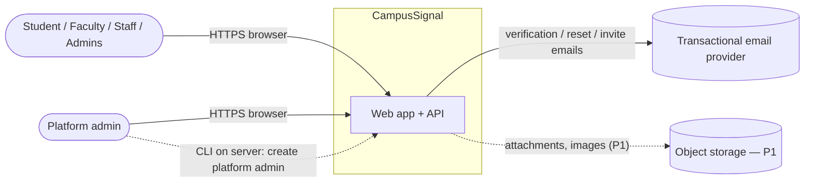
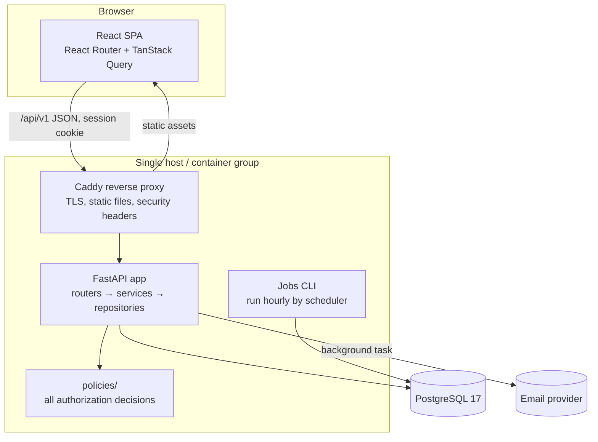
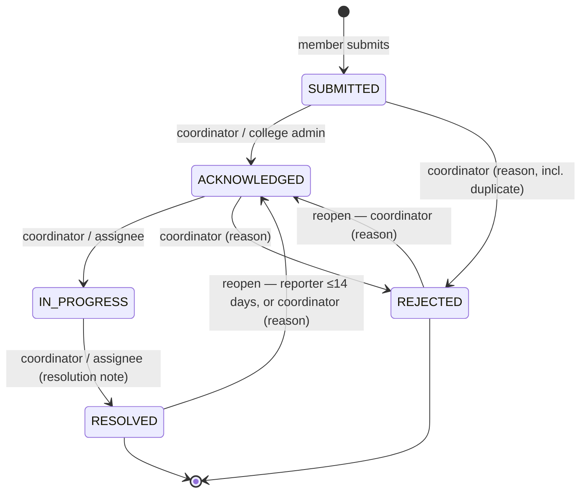
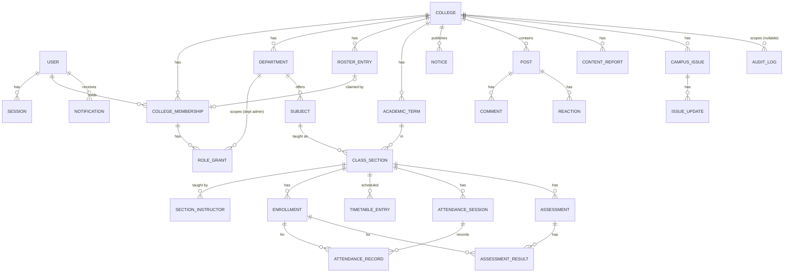

# CampusSignal — Technical Architecture

| | |
|---|---|
| Status | Proposed design v0.1 — nothing described here is implemented yet (see `memory.md`) |
| Last updated | 2026-10-20 |
| Requirements source | `PRD.md` (requirement IDs referenced inline) |

All diagrams in this document are **proposed designs**, not depictions of running systems.

---

## 1. Architecture overview

CampusSignal is a **modular monolith**: one FastAPI backend, one React single-page application, one PostgreSQL database, served same-origin behind a reverse proxy. Modules (auth, membership, notices, community, issues, academic, notifications, admin) are separated by package boundaries inside the backend, not by network boundaries.

Why: a small team, a single relational domain with heavy cross-module authorization (every module depends on membership and roles), and no workload that needs independent scaling. Microservices, message brokers, Redis, GraphQL, and Kubernetes are explicitly **not** used (§23).

## 2. System context



No integration with college ERP/university systems exists or is assumed (PRD §22).

## 3. Major application components



| Component | Responsibility |
|---|---|
| React SPA | All UI; no authorization decisions (UX hiding only). |
| Caddy | TLS termination, serves built SPA, proxies `/api`, sets security headers. |
| FastAPI app | HTTP API. Routers parse/validate, resolve actor and campus context, call services. |
| Policies | Pure functions deciding whether an actor may perform an action on an object. |
| Services | Business logic and transactions. |
| Repositories | SQLAlchemy queries; every college-scoped query requires a `college_id`. |
| Jobs CLI | `python -m app.jobs run-due`: retention purges (expired sessions/tokens, old notifications, rate counters). Idempotent. Scheduled-notice dispatch is added with NOTICE-011 (P1). |

## 4. Technology stack

The repository's existing `CLAUDE.md` already fixes this stack; this document adopts it and adds only what the requirements need.

| Layer | Choice | Justification |
|---|---|---|
| Frontend framework | React (current stable major, pinned at Phase 1) + TypeScript (strict) + Vite | Already chosen; large ecosystem; strict types catch contract drift. |
| Routing | React Router | Already chosen; nested layouts map to role-based shells. |
| Server state | TanStack Query | Caching, retries, polling (NOTIF-005) without a global store. No Redux. |
| Styling/components | Tailwind CSS + shadcn/ui (Radix primitives) | Token-driven theming (`Design.md`), accessible primitives, code owned in-repo. |
| Forms | react-hook-form + zod | **New dependency** — accessible, typed client validation mirroring server schemas; avoids hand-rolled form state. |
| Backend | Python 3.12 + FastAPI | Already chosen; Pydantic validation at the boundary; dependency injection fits actor/campus resolution. |
| ORM/migrations | SQLAlchemy 2.x (sync) + Alembic | Already chosen. **Sync** sessions with `def` endpoints: simpler tests and transactions; throughput is adequate for per-college scale. |
| DB driver | psycopg 3 (`psycopg[binary]`) | Maintained, supports Postgres 17; binary wheels avoid a separate libpq install on Windows. |
| Validation | Pydantic v2 (`extra="forbid"`) | Rejects unknown fields → blocks mass assignment (PRD §17.4). |
| Password hashing | argon2-cffi (Argon2id) | Required by `CLAUDE.md` and AUTH-002. |
| Database | PostgreSQL 17 | Relational integrity, partial unique indexes, composite FKs, `citext`, `timestamptz`. Development: hosted Supabase project (ADR-14); CI: disposable Postgres 17 service; production: pending P-1. |
| Python tooling | uv, ruff, pytest, httpx2 TestClient | Already chosen. |
| Frontend tests | Vitest + Testing Library; Playwright + @axe-core/playwright | Already chosen; axe adds accessibility checks (NFR-A11Y-001). |
| CI | GitHub Actions | Already chosen. |
| Reverse proxy | Caddy | Automatic TLS, simple config, same-origin serving (simplifies cookies/CSRF). |
| Fonts | @fontsource packages (self-hosted) | **New dependency** — no third-party font requests; see `Design.md`. |
| Notice Markdown | react-markdown + rehype-sanitize (Phase 4) | **New dependency** — renders the NOTICE-001 subset with raw HTML disabled; hand-written Markdown parsing would be an XSS risk. |
| API types | openapi-typescript (dev only) | **New dev dependency** — generates client types from the OpenAPI schema (§6). |

## 5. Repository layout (proposed)

```
backend/
  app/
    main.py               # app factory, router registration, middleware
    core/                 # config, db, security (hashing, tokens), sessions, csrf, ratelimit, errors, logging
    api/v1/               # routers only
    models/               # SQLAlchemy models
    schemas/              # Pydantic request/response models
    services/             # business logic per module
    repositories/         # queries per module
    policies/             # authorization functions per module
    jobs/                 # scheduled jobs entrypoint
    cli/                  # create-platform-admin, seed-demo
  alembic/
  tests/                  # unit/, api/, isolation/, factories.py
frontend/
  src/
    app/                  # router, providers, shells per role
    components/ui/        # shadcn components
    components/           # shared composites (NoticeItem, PostItem, StatusBadge...)
    features/<module>/    # auth, campus, notices, community, issues, academic, notifications, admin, platform
    lib/                  # api client, csrf, formatting
  e2e/                    # Playwright
deploy/                   # Caddyfile, compose.prod.yml
```

Folders are created only when a phase needs them (`Rules.md` R-1.9).

## 6. Frontend architecture

- **Shells by audience:** `AuthShell` (signed out), `CampusShell` (member), `PlatformShell` (platform admin). Navigation items are computed from `/api/v1/me` (membership kind + grants) — UX only.
- **Data access:** one typed `apiClient` (fetch wrapper) adding `X-CSRF-Token`, `credentials: "same-origin"`, parsing the error envelope (§12) into a typed `ApiError`. Each feature exposes query hooks (`useNotices`, `useIssue(id)`) with stable query keys.
- **Auth state:** derived from `GET /api/v1/me`; a 401 from any request clears the cache and redirects to sign-in with a return URL.
- **Types:** request/response types generated from the FastAPI OpenAPI schema (`openapi-typescript`, dev-only dependency) so client and server cannot drift silently.
- **Routing:** route-level lazy loading; route guards redirect when the user lacks a membership, but every guarded screen still handles 403/404 from the API.
- **State rule:** server state in TanStack Query only; local UI state in components; no global store.

## 7. Backend architecture

Request pipeline:

```
middleware: request_id → security headers (dev) → session load → CSRF check (unsafe methods)
router: parse & validate (Pydantic) → Depends(current_actor) → Depends(campus_context)
service: load object via repository (college-scoped) → policy check → mutate → audit → commit
router: serialize response schema
```

Key dependencies (FastAPI `Depends`):

| Dependency | Returns | Fails with |
|---|---|---|
| `current_user` | `User` with ACTIVE status from session | 401 `not_authenticated` |
| `current_actor` | `Actor(user, membership | None, grants, platform_role)` | 401 |
| `campus_context` | `CampusContext(college_id, membership, grants)` from the user's single ACTIVE membership in an ACTIVE college | 403 `membership_required` / `membership_inactive` / `college_inactive` |
| `platform_admin` | `Actor` with `PLATFORM_ADMIN` | 404 (route existence not revealed) |

Layer rules:
- Routers contain no queries and no permission logic beyond calling dependencies and services.
- Services own transactions (`with session.begin():`) and call policies.
- Repositories never decide permissions; college-scoped repository functions take `college_id` as a required argument.
- Policies are pure functions: `can_edit_attendance(actor, session_obj, now) -> bool`. They never query the database; services pass in the loaded objects.

### 7.1 Campus issue lifecycle

Implemented as a pure transition table in `services/issues/state_machine.py` (PRD §9.8.1). Every transition writes an `issue_updates` row and, for audited transitions, an `audit_log` row in the same transaction.



## 8. Database architecture

### 8.1 Conventions
- UUID v4 primary keys (`gen_random_uuid()`), `timestamptz` in UTC for instants, `date` for calendar dates in the college's timezone.
- `created_at`, `updated_at` on all mutable tables; `version int` on tables with concurrent edits (attendance sessions, assessments results, issues).
- Enums as PostgreSQL `text` + `CHECK` constraints (easier migrations than native enums).
- `citext` for emails.
- Soft delete (`deleted_at`) only where content must remain referenceable (posts, comments); hard delete elsewhere.

### 8.2 MVP entity model



| Entity | Key columns | Constraints / indexes |
|---|---|---|
| `users` | email citext, password_hash, display_name, email_verified_at, status, platform_role | UNIQUE(email) |
| `sessions` | id_hash, user_id, created_at, last_seen_at, expires_at, csrf_secret | PK id_hash; idx(user_id) |
| `user_tokens` | user_id, purpose (VERIFY_EMAIL, RESET_PASSWORD), token_hash, expires_at, used_at | UNIQUE(token_hash) |
| `colleges` | name, slug, timezone (IANA), status, email_domains text[], attendance_edit_window_hours (default 48), is_demo (set at creation by platform admin; drives "Demo data" labelling) | UNIQUE(slug) |
| `departments` | college_id, code, name, description, archived_at | UNIQUE(college_id, code) |
| `college_memberships` | user_id, college_id, kind, status, department_id, roster_entry_id NULL, verification_flag NULL (MEMBER-004), submitted_roll_number NULL (only for `NO_ROSTER_MATCH`), decided_by, decision_reason | partial UNIQUE(user_id, college_id) WHERE status IN ('PENDING','ACTIVE','SUSPENDED'); **partial UNIQUE(user_id) WHERE status='ACTIVE'** (MEMBER-008); partial UNIQUE(roster_entry_id) WHERE status='ACTIVE' (MEMBER-005) |
| `roster_entries` | college_id, department_id, roll_number, full_name, email, program, admission_year | UNIQUE(college_id, roll_number) |
| `invites` | college_id, email, kind, grants jsonb, token_hash, expires_at, accepted_at | UNIQUE(token_hash) |
| `role_grants` | college_id, membership_id, role, department_id | UNIQUE(membership_id, role, department_id) NULLS NOT DISTINCT; CHECK(role='DEPARTMENT_ADMIN' ⇔ department_id IS NOT NULL) |
| `academic_terms` | college_id, name, starts_on, ends_on, is_current | partial UNIQUE(college_id) WHERE is_current |
| `subjects` | college_id, department_id, code, name | UNIQUE(college_id, code) |
| `class_sections` | college_id, term_id, subject_id, name | UNIQUE(term_id, subject_id, name) |
| `section_instructors` | college_id, section_id, membership_id | UNIQUE(section_id, membership_id) |
| `enrollments` | college_id, section_id, membership_id | UNIQUE(section_id, membership_id) |
| `timetable_entries` | college_id, section_id, weekday, starts_at time, ends_at time, room | exclusion constraint: no overlap per (section, weekday) |
| `attendance_sessions` | college_id, section_id, held_on date, slot smallint, recorded_by, version | UNIQUE(section_id, held_on, slot) |
| `attendance_records` | college_id, attendance_session_id, enrollment_id, status | UNIQUE(attendance_session_id, enrollment_id) |
| `assessments` | college_id, section_id, name, kind, max_score numeric(6,2), held_on, published_at | idx(section_id) |
| `assessment_results` | college_id, assessment_id, enrollment_id, score numeric(6,2) NULL, is_absent, revised_at, version | UNIQUE(assessment_id, enrollment_id); CHECK(score ≥ 0) |
| `notices` | college_id, department_id NULL, author_membership_id, title, body, category, priority, scope, status, published_at, expires_at, edited_at | idx(college_id, status, published_at DESC); CHECK(scope='DEPARTMENT' ⇔ department_id IS NOT NULL) |
| `posts` | college_id, author_membership_id, visibility, department_id NULL, body, status (VISIBLE, HIDDEN), edited_at, deleted_at | idx(college_id, visibility, department_id, created_at DESC, id DESC) |
| `comments` | college_id, post_id, author_membership_id, body, status, deleted_at | idx(post_id, created_at) |
| `reactions` | college_id, post_id, membership_id | UNIQUE(post_id, membership_id) |
| `content_reports` | college_id, reporter_membership_id, target_type, target_id, reason, note, status, handled_by, handled_at | partial UNIQUE(reporter_membership_id, target_type, target_id) WHERE status='OPEN' |
| `campus_issues` | college_id, reporter_membership_id, category, title, description, location_text, status, assignee_membership_id, duplicate_of_id, resolved_at, reporter_reopen_count, version | idx(college_id, status, created_at); composite FKs for assignee and duplicate_of; CHECK(duplicate_of_id <> id) |
| `issue_updates` | college_id, issue_id, actor_membership_id NULL (system), kind, from_status, to_status, body, is_internal | append-only |
| `notifications` | user_id, college_id, type, subject_type, subject_id, title, read_at, created_at | idx(user_id, created_at DESC); partial idx(user_id) WHERE read_at IS NULL |
| `audit_log` | college_id NULL, actor_user_id, action, target_type, target_id, reason, metadata jsonb, created_at | append-only: the application DB role has INSERT/SELECT only; the retention purge (§8.3) runs as a separate maintenance role |
| `rate_limit_counters` | bucket_key, window_start, count | PK(bucket_key, window_start) |

**Deferred entities/columns** (not created until their phase): `events`, `event_registrations`, `attachments`, `notice_reads`, `idempotency_keys` (NFR-REL-002), `notices.publish_at`/`notified_at` (NOTICE-011), `notices.audience` (NOTICE-012) — all Phase 11; `buildings` (free-text location suffices for MVP).

### 8.3 Deletion and retention
- Users are deactivated, not deleted, in MVP; account deletion (P1) pseudonymizes.
- `ON DELETE RESTRICT` by default; `CASCADE` only from a parent to purely dependent rows (e.g., `attendance_sessions` → `attendance_records`, `posts` → `reactions`).
- Academic rows are never cascaded from membership changes; ending a membership keeps records.
- Retention jobs (Jobs CLI): sessions at expiry, tokens 7 days after expiry, notifications at 90 days, rate counters at 1 day. Audit log retained 2 years [Assumption].

## 9. Tenant isolation strategy

[Decision] **Shared database, shared schema, `college_id` discriminator column, enforced by four layers:**

1. **Context resolution.** Campus endpoints live under `/api/v1/campus/...` and accept **no** college identifier. `campus_context` loads the user's single ACTIVE membership (MEMBER-008) and its college; the college must be ACTIVE. The resulting `college_id` is the only one used for the request (TENANT-001).
2. **Scoped repositories.** Every repository function for a college-scoped table takes `college_id` and includes it in the `WHERE` clause. Lookup-by-ID is always `WHERE id = :id AND college_id = :college_id`; a miss raises `NotFound` → 404 (TENANT-002). Platform endpoints that legitimately cross colleges live in separate `platform_*` repositories.
3. **Policies.** After loading, a policy checks role, department, assignment, visibility. Objects the actor may not *read* produce 404; objects they may read but not *modify* produce 403.
4. **Database integrity.** Each college-scoped table has `UNIQUE (college_id, id)`, and child tables reference parents with **composite foreign keys** `(college_id, parent_id) → parent(college_id, id)`. This makes it impossible to store, e.g., an enrollment linking college A's section to college B's membership, even if application code is wrong.

**Users and colleges:** a `User` is platform-wide (identity); a `CollegeMembership` connects a user to a college with a kind and status. Data model allows multiple memberships over time (e.g., ENDED then new ACTIVE) but only one ACTIVE at a time in MVP. Lifting that later requires a college switcher and an explicit `X-College` selection validated against memberships — never trusted on its own.

**Public vs private content:** in the MVP the only cross-college data is the **college directory** (`GET /api/v1/colleges`: name, slug for ACTIVE colleges) used during joining. Public events and a cross-college feed are P2 and will use separate tables/endpoints with explicit `visibility='PUBLIC'` and their own policies.

**Platform admins:** authorized via `users.platform_role`, created only by CLI (ADMIN-005). Platform routes live under `/api/v1/platform/...` and use only platform repositories, which expose college metadata and admin-invite management — not posts, issues, notices, or academic tables (ADMIN-008). [Decision, P-7] A `PLATFORM_ADMIN` account cannot hold or accept a college membership (enforced in membership-request and invite-acceptance services), which closes the path "platform admin invites themselves as college admin and reads academic data". Platform-issued admin invites to colleges that already have a college admin require a reason, are audit-logged, and notify that college's admins.

**PostgreSQL Row-Level Security:** evaluated and **deferred** (P2). RLS would require setting a per-transaction `app.college_id` and maintaining policies on ~25 tables, adding a second place where mistakes can hide; the composite-FK + scoped-repository + test-suite approach covers the MVP. Re-evaluate in Phase 9; if adopted, it is defense in depth and does not replace policies.

**Database privileges for Supabase API roles (migration `0002`, ADR-14):** the backend is the only database client: it connects directly over the session pooler as the owning role (`postgres`). Supabase's Data API is disabled on the development project, but disabling it does not remove PostgreSQL grants, and Supabase grants its API roles `anon` and `authenticated` full access in `public` by default. Migration `0002` therefore, where those roles exist:
- revokes all their privileges on existing tables, views and sequences in `public` (including `alembic_version`);
- revokes the default privileges that would grant them access to tables, sequences and functions the migrating role creates in `public` later.

It is a no-op on plain PostgreSQL (CI). Verified on the development project 2026-10-21: no API-role grants on any `public` table; newly created tables and sequences get none. Limits: default privileges are per creating role, so migrations must keep running as the owning role; `supabase_admin`'s own default grants (it owns the citext functions) cannot be changed by `postgres` and are left alone; PostgreSQL still lets `PUBLIC` execute newly created functions, so any function added later must `REVOKE EXECUTE … FROM PUBLIC` (Rules R-2.22). `service_role` (server-side key, unused by the backend) is unchanged. Downgrade of `0002` is a deliberate no-op (§20).

**Limitations (accepted):** a bug in a repository that omits `college_id` is caught by tests and review, not by the database (except for writes, where composite FKs help). Mitigations: repository base helpers that require `college_id`; isolation test suite (§17); code review checklist (`Rules.md` §2).

## 10. Authentication and authorization

```mermaid
sequenceDiagram
    participant B as Browser
    participant P as Caddy
    participant A as FastAPI
    participant D as PostgreSQL
    B->>P: POST /api/v1/campus/issues (cookie cs_session, X-CSRF-Token)
    P->>A: forward
    A->>D: SELECT session by sha256(cookie)
    alt missing session or standard limits exceeded
        A-->>B: 401 not_authenticated
    end
    A->>A: verify CSRF token vs session secret, Origin allowed
    A->>D: load user (ACTIVE?) + ACTIVE membership + college (ACTIVE?) + grants
    alt privileged role and 24 h idle / 7 d absolute exceeded
        A-->>B: 401 not_authenticated (session deleted)
    end
    alt no active membership / college inactive
        A-->>B: 403 membership_required or college_inactive
    end
    A->>A: validate body (Pydantic, extra=forbid)
    A->>A: rate limit check (DB counter)
    A->>A: policy can_create_issue(actor)
    A->>D: BEGIN; insert issue(college_id from context); insert issue_update; audit; COMMIT
    A-->>B: 201 issue (response schema)
```

- **Sessions** (AUTH-004): 256-bit random token in cookie `cs_session` (`HttpOnly; Secure; SameSite=Lax; Path=/`); DB stores SHA-256 of it. Idle timeout via `last_seen_at` (updated at most once per 5 minutes to limit writes).
- **Privileged sessions** (AUTH-013): after loading the actor, `current_actor` checks whether the user currently has an ACTIVE FACULTY membership or a COLLEGE_ADMIN/DEPARTMENT_ADMIN grant; if so it applies `PRIVILEGED_SESSION_IDLE_HOURS` (24) against `last_seen_at` and `PRIVILEGED_SESSION_ABSOLUTE_DAYS` (7) against `created_at`, deleting the session and returning 401 when exceeded. No session column stores the tier, so role changes apply immediately. Because `last_seen_at` is written at most every 5 minutes, idle precision is ±5 minutes. Platform-admin sessions: P-10.
- **CSRF** (AUTH-008): `Origin` must match `APP_ORIGIN` on **every** POST/PUT/PATCH/DELETE, including unauthenticated `/auth/*` routes (blocks login CSRF). With a session, additionally a per-session secret; token exposed via `GET /api/v1/auth/csrf` and a non-HttpOnly `cs_csrf` cookie; required in `X-CSRF-Token`.
- **Client IP:** taken from the `X-Forwarded-For` value appended by Caddy only (uvicorn/gunicorn `forwarded_allow_ips` set to the proxy address); never from arbitrary client headers. Used for IP rate limits only and not logged in full.
- **Authorization data freshness:** user status, membership, and grants are loaded on every request, so suspensions and role changes apply immediately (AUTH-004).
- **Why not JWT:** server-side sessions allow immediate revocation (suspension, password reset) and keep tokens out of JavaScript, as required by `CLAUDE.md`.
- **Passwords:** Argon2id with argon2-cffi defaults reviewed at Phase 2 (memory ≥ 19 MiB, t ≥ 2); rehash on login if parameters change.
- **Email tokens:** verification/reset/invite tokens are random 256-bit, stored hashed, single use, expiring.
- **Rate limiting:** fixed-window counters in `rate_limit_counters` (works across workers without Redis). Keys: `login:email:<sha256(normalized email)>` (applies even when no account exists — AUTH-007), `login:ip:<ip>`, `issue:create:<membership_id>`, etc.
- **Authorization:** role/attribute checks in `app/policies/<module>.py`. A route inventory test enumerates FastAPI routes and fails if a non-public route lacks a policy-calling dependency marker.

## 11. API conventions

- Base path `/api/v1`. JSON only. `snake_case` fields. Timestamps ISO-8601 UTC with `Z`; dates `YYYY-MM-DD`.
- Namespaces: `/auth` (public/session), `/me` (current user, not college-scoped), `/colleges` (directory for joining), `/campus` (tenant-scoped, context from session; `/campus/me/*` = the current member's own college-scoped data), `/platform` (platform admins).
- Collections: cursor pagination `?cursor=<opaque>&limit=20` (max 50) → `{ "items": [...], "next_cursor": "..." | null }`. Cursor = base64 of `(sort_key, id)`; stable under inserts.
- `Idempotency-Key` on creation endpoints is deferred to Phase 11 (NFR-REL-002); MVP clients disable submit while a request is pending.
- Optimistic concurrency: mutable contested resources return `version`; updates send it; mismatch → 409 `version_conflict`.
- OpenAPI schema is the contract; frontend types are generated from it.

### 11.1 Representative endpoints (MVP only)

Auth column: **—** public, **U** signed-in user, **M** ACTIVE member (campus context), **PA** platform admin. All `/campus` routes are tenant-bounded by the session-derived college; any object outside it → 404.

**Auth & me**

| Method | Route | Purpose | Auth / policy | Notable failures |
|---|---|---|---|---|
| POST | `/auth/register` | Create account (AUTH-001) | — | 422 weak password; 429 |
| POST | `/auth/verify-email` | Consume token | — | 400 `token_invalid`/`token_expired` |
| POST | `/auth/resend-verification` | Resend | U | 429 |
| POST | `/auth/login` | Create session | — | 401 generic; 429 |
| POST | `/auth/logout` · `/auth/logout-all` | End session(s) | U | 401 |
| POST | `/auth/password-reset/request` · `/confirm` | Reset (AUTH-006) | — | always 202 on request; 400 token |
| GET | `/auth/csrf` | Issue CSRF token | — | — |
| GET | `/me` | User, membership, grants, nav capabilities | U | 401 |
| POST | `/me/password` | Change password | U | 400 wrong current |

**Membership & college directory**

| Method | Route | Purpose | Auth / policy | Notable failures |
|---|---|---|---|---|
| GET | `/colleges` | ACTIVE colleges (name, slug) | U | — |
| POST | `/me/membership-requests` | Request student membership `{college_slug, roll_number}`; uniform 202 for every non-auto-activated outcome (MEMBER-004) | U, email verified, not platform admin (P-7) | 403 unverified or platform admin; 409 already active/pending; 429 |
| POST | `/invites/{token}/accept` | Accept faculty/staff/admin invite; marks email verified | U, email matches, not platform admin (P-7) | 400 invalid/expired; 403 platform admin |
| GET | `/campus/membership-requests?status=PENDING` | Approval queue | M, `can_review_membership` (college admin, dept admin for dept) | 403 |
| POST | `/campus/membership-requests/{id}/approve` · `/reject` | Decide | M, same policy; reason on reject | 404 cross-tenant; 409 already decided |
| POST | `/campus/roster/import` | CSV roster (MEMBER-001) | M, college admin | 422 row errors (all-or-nothing) |
| POST | `/campus/invites` | Invite faculty/staff | M, college admin | 409 already member |
| GET | `/campus/members?query=&kind=` | Member directory (fields per PRD §17.6) | M, college admin (all) or dept admin (own-dept students + college faculty/staff) | 403 |
| GET | `/campus/assignees?query=` | ACTIVE faculty/staff names for issue assignment | M, coordinator or college admin | 403 |
| PATCH | `/campus/members/{id}` | Change department, suspend, end | M, college admin | 404; 409 last admin |
| PATCH | `/me/profile` | Change display name (PROFILE-001) | U | 422 |
| POST/DELETE | `/campus/members/{id}/grants` | Grant/revoke roles | M, college admin | 409 last college admin; 422 student grant |

**Departments & notices**

| Method | Route | Purpose | Auth / policy | Notable failures |
|---|---|---|---|---|
| GET | `/campus/departments` · `/{id}` | List / detail page data | M | 404 |
| POST/PATCH | `/campus/departments` · `/{id}` | Create/edit/archive | M, college admin (dept admin: description only) | 409 code taken |
| GET | `/campus/notices?category=&department_id=&cursor=` | Visible notices (NOTICE-004/005) | M, `can_read_notice` applied in query | — |
| GET | `/campus/notices/{id}` | Detail | M, `can_read_notice` | 404 |
| POST | `/campus/notices` | Create draft or publish immediately (no `publish_at`/`audience` in MVP — unknown fields → 422) | M, `can_publish_notice(scope, department)` | 403 scope; 404 department |
| PATCH | `/campus/notices/{id}` | Edit | M, author or same-scope admin | 404; 409 version |
| POST | `/campus/notices/{id}/withdraw` | Withdraw with reason | M, same | 422 no reason |

**Community**

| Method | Route | Purpose | Auth / policy | Notable failures |
|---|---|---|---|---|
| GET | `/campus/posts?feed=college|department&department_id=&cursor=` | Feed | M, `can_read_post` in query | 404 department not accessible |
| POST | `/campus/posts` | Create | M, `can_post(visibility)` | 403 other dept; 429 |
| GET/PATCH/DELETE | `/campus/posts/{id}` | Read/edit/delete own | M, author for edit/delete | 404 |
| GET/POST | `/campus/posts/{id}/comments` | List/add | M, `can_read_post` | 404; 429 |
| PATCH/DELETE | `/campus/comments/{id}` | Edit/delete own | M, author | 404 |
| PUT/DELETE | `/campus/posts/{id}/reaction` | Toggle reaction | M, `can_read_post` | 404 |
| POST | `/campus/reports` | Report content | M, `can_read_target` | 409 open report exists |
| GET | `/campus/moderation/reports` | Queue | M, moderator | 403 |
| POST | `/campus/moderation/reports/{id}/resolve` | Hide content / dismiss | M, `can_moderate(target)` | 403 dept admin on college post |

**Campus issues**

| Method | Route | Purpose | Auth / policy | Notable failures |
|---|---|---|---|---|
| POST | `/campus/issues` | Submit | M | 422; 429 |
| GET | `/campus/issues?scope=mine|assigned|queue&status=&category=&cursor=` | Lists | M; `queue` requires coordinator/college admin | 403 queue |
| GET | `/campus/issues/{id}` | Detail + updates (internal filtered for reporter); for a duplicate, includes `duplicate_of: {status, resolved_at}` only (ISSUE-006) | M, `can_read_issue` | 404 |
| POST | `/campus/issues/{id}/transitions` `{to_status, note, version}` | State change (§9.8.1) | M, `can_transition_issue` | 409 invalid transition/version; 422 missing note |
| POST | `/campus/issues/{id}/assignment` | Assign/unassign | M, coordinator | 404 assignee not in college |
| POST | `/campus/issues/{id}/updates` | Comment (internal flag only for staff side) | M, `can_comment_issue` | 404 |

**Academic**

| Method | Route | Purpose | Auth / policy | Notable failures |
|---|---|---|---|---|
| CRUD | `/campus/terms` | Terms | M, college admin | 409 overlapping current |
| CRUD | `/campus/subjects`, `/campus/sections` | Catalog | M, dept admin of subject's dept, or college admin | 404 |
| PUT | `/campus/sections/{id}/instructors` | Assign faculty | M, dept admin of dept, or college admin | 422 non-faculty |
| POST/DELETE | `/campus/sections/{id}/enrollments/import` · `/campus/enrollments/{id}` | CSV roll numbers / remove | M, dept admin of dept, or college admin | 422 unknown or non-student roll numbers listed; 409 remove with records |
| CRUD | `/campus/sections/{id}/timetable` | Timetable | M, dept admin of dept, or college admin | 409 overlap |
| GET | `/campus/me/timetable` | Student weekly view | M, student | — |
| GET | `/campus/teaching/sections` | Faculty's assigned sections | M, faculty | — |
| POST | `/campus/sections/{id}/attendance-sessions` | Record session + records | M, `can_record_attendance` | 404 not assigned; 409 duplicate; 422 future/out-of-term date |
| GET | `/campus/sections/{id}/attendance-sessions` · `/campus/attendance-sessions/{id}` | Section attendance view | M, assigned faculty, dept admin of dept, college admin | 404 |
| PATCH | `/campus/attendance-sessions/{id}` | Edit records (window/reason rules) | M, `can_edit_attendance(now)` | 403 window closed; 409 version |
| GET | `/campus/me/attendance` · `/campus/me/attendance/{section_id}` | Student summary/detail | M, own enrollment | 404 |
| POST | `/campus/sections/{id}/assessments` | Create assessment | M, assigned faculty | 404 |
| GET | `/campus/sections/{id}/assessments` · `/campus/assessments/{id}/results` | Section results view (incl. unpublished) | M, assigned faculty, dept admin of dept, college admin | 404 |
| PUT | `/campus/assessments/{id}/results` | Bulk upsert scores | M, assigned faculty; reason if published | 422 score > max |
| POST | `/campus/assessments/{id}/publish` | Publish | M, assigned faculty or dept admin | 409 already published |
| GET | `/campus/me/results` | Student's published results | M, own | — |

**Notifications, audit, platform**

| Method | Route | Purpose | Auth / policy | Notable failures |
|---|---|---|---|---|
| GET | `/me/notifications?cursor=` · `/me/notifications/unread-count` | List / count (own rows; college-less or current college only — NOTIF-001) | U | — |
| GET | `/campus/home` | Role-aware home blocks (HOME-001..004), composed from module services | M | partial block errors returned per block |
| POST | `/me/notifications/{id}/read` · `/me/notifications/read-all` | Mark read | U, owner | 404 |
| GET | `/campus/audit-log?actor=&action=&from=&to=&cursor=` | College audit | M, college admin | 403 |
| GET/POST | `/platform/colleges` | List/create colleges | PA | 409 slug |
| PATCH | `/platform/colleges/{id}` | Activate/suspend/edit | PA | 409 invalid transition |
| POST | `/platform/colleges/{id}/admin-invites` | Invite first college admin | PA | — |
| POST | `/platform/users/{id}/suspend` · `/unsuspend` | Platform suspension | PA, reason | 409 self |
| GET | `/platform/audit-log` | Platform-level audit | PA | — |

## 12. Error-handling conventions

Single envelope for all non-2xx responses:

```json
{ "error": { "code": "version_conflict", "message": "This issue was changed by someone else. Reload and try again.", "details": null, "request_id": "01J..." } }
```

| Status | Use |
|---|---|
| 400 | Malformed request, invalid/expired token |
| 401 | `not_authenticated` |
| 403 | Authenticated, can see the object (or no object involved), not allowed: `forbidden`, `membership_required`, `college_inactive`, `edit_window_closed` |
| 404 | `not_found` — also for cross-tenant and not-readable objects; identical body |
| 409 | `conflict`, `version_conflict`, `invalid_transition`, `duplicate` |
| 422 | `validation_error` with `details: [{field, message}]` |
| 429 | `rate_limited` with `Retry-After` |
| 500 | `internal_error`; message generic; stack traces only in logs |

Domain exceptions (`NotFound`, `Forbidden`, `Conflict`, ...) are raised in services and mapped by one exception handler. Messages never include other users' data, roll numbers, or SQL.

## 13. Validation strategy

- **Server is authoritative:** Pydantic schemas (`extra="forbid"`, length limits, enums, `constr` patterns) at the boundary; business rules (transitions, windows, capacity) in services; invariants in DB constraints.
- **Client mirrors** constraints with zod for immediate feedback; client validation is never trusted.
- CSV imports: parsed with the standard `csv` module, size limit 2 MB / 5,000 rows, UTF-8 required, header validated, every row validated before any write; response lists row-level errors.
- Markdown in notices rendered client-side with a sanitizing renderer limited to the allowed subset; raw HTML disabled.

## 14. File and image storage

Not in the MVP (PRD §14). Planned for Phase 11:
- `Storage` interface with `LocalStorage` (dev) and `S3Storage` (prod, S3-compatible) implementations.
- Upload flow through the API (not pre-signed direct uploads) to keep validation simple: size check, magic-byte type sniffing, image re-encoding with EXIF strip (Pillow), random object keys, `attachments` row with `college_id` and owner. Downloads go through an authorized endpoint that re-checks the parent object's policy and streams or redirects to a short-lived signed URL.

## 15. Notification architecture

- **In-app only** (NOTIF-001..005). Rows in `notifications`, created in the **same transaction** as the triggering change (e.g., issue transition), so they cannot be lost or duplicated.
- **Fan-out** for HIGH/URGENT notices: one `INSERT ... SELECT` over ACTIVE memberships in the notice's scope, in the publish transaction. (Scheduled notices, P1, will add a `notified_at` guard and fan-out from the Jobs CLI.) Expected size per college ≤ 20k rows per notice — acceptable for PostgreSQL.
- **Delivery to browser:** polling `unread-count` every 60 s while the tab is visible and on focus. No WebSockets/SSE in MVP.
- **Account emails** (verification, reset, invites) are sent only after the database transaction commits, via FastAPI `BackgroundTasks` through an `EmailSender` interface (`ConsoleEmailSender` in tests, SMTP in dev via Mailpit, provider in prod). Failure is logged; the user can resend. A durable outbox is P1 if delivery problems appear.

## 16. Logging and monitoring

- JSON logs to stdout: timestamp, level, request_id, route template (not raw path with IDs where possible), status, latency, user_id (UUID), college_id. **Never**: passwords, cookies, CSRF/session/reset tokens, request bodies of academic endpoints, roll numbers, emails, scores.
- A log-scrubbing filter drops known sensitive keys as a backstop.
- `GET /healthz` (process up), `GET /readyz` (DB reachable, migrations at head).
- Error tracking: pending decision P-6 (Sentry with PII scrubbing, or none).
- Audit log is a business record in the DB, separate from operational logs.

## 17. Testing architecture

| Level | Tooling | Scope |
|---|---|---|
| Unit | pytest | Policies (exhaustive role × object tables), issue state machine, attendance window rules, pagination cursor, token utilities |
| Service/integration | pytest + real PostgreSQL 17 (GitHub Actions `postgres:17.11` service in `.github/workflows/backend.yml`; `integration` marker, needs `TEST_DATABASE_URL`, run only against a positively identified disposable DB — loopback host, database name `*_test`, no Supabase roles on the server — otherwise the run stops; in CI a missing `TEST_DATABASE_URL` fails instead of skipping; covers migration round trips, `alembic check`, `/readyz` ready/pending, and `0002` privileges with and without simulated Supabase roles) | Services with transactions and constraints; each test in a rolled-back transaction |
| API | pytest + httpx2 TestClient | Every endpoint: allow, cross-college deny (404 + no private fields), wrong-role deny |
| Tenant isolation | pytest, parametrized | Seeds "Northfield Institute" and "Riverside College" with one object of every type; for every college-scoped route × method, actor from B targets A's object → expect 404/403 and no leaked fields; list endpoints must not include A's items |
| Route inventory | pytest | Every route is public-allowlisted or carries a policy marker |
| Query count | pytest fixture | Feeds/lists assert bounded query counts (no N+1) |
| Frontend unit | Vitest + Testing Library | Components' loading/empty/error states, form validation |
| E2E | Playwright + axe | J1–J9 critical journeys; mobile (390 px) and desktop (1280 px) |

Factories in `tests/factories.py` create users, colleges, memberships with grants. Seeds are synthetic.

## 18. Deployment architecture

[Pending P-1 — hosting provider.] Target shape regardless of provider:

- One Linux host or container platform running: `caddy` (TLS, static SPA, proxy), `api` (gunicorn with uvicorn workers, 2–4 workers), scheduled `jobs` hourly (platform cron or systemd timer).
- Managed PostgreSQL 17 with automated backups and point-in-time recovery if available.
- Environments: `local` (each developer's Supabase development project via the session pooler, ADR-14; Mailpit standalone binary for email from Phase 2), `ci` (disposable Postgres 17 service), `staging`, `production`. Staging mirrors production config with synthetic data only.
- Migrations run as a release step before new API containers start (`alembic upgrade head`); migrations must be backward compatible with the previous app version (expand → migrate → contract).

## 19. Environment configuration

Settings via pydantic-settings from environment; `.env.example` documents every variable without values.

| Variable | Purpose |
|---|---|
| `APP_ENV` | local / ci / staging / production |
| `DATABASE_URL` | PostgreSQL DSN, `postgresql+psycopg://…`; non-localhost hosts must set `sslmode=require` or stricter (validated at startup). Held as a secret: never logged or echoed in errors |
| `TEST_DATABASE_URL` | Integration tests only: a disposable Postgres 17 (CI). Tests refuse Supabase hosts |
| `APP_ORIGIN` | Allowed origin for CSRF/Origin checks and email links |
| `SESSION_IDLE_DAYS`, `SESSION_ABSOLUTE_DAYS` | Standard sessions; defaults 7 / 30 |
| `PRIVILEGED_SESSION_IDLE_HOURS`, `PRIVILEGED_SESSION_ABSOLUTE_DAYS` | Privileged sessions (AUTH-013); defaults 24 / 7 |
| `EMAIL_BACKEND`, `SMTP_HOST`, `SMTP_PORT`, `SMTP_USER`, `SMTP_PASSWORD`, `EMAIL_FROM` | Email |
| `LOG_LEVEL` | Logging |
| `SENTRY_DSN` (optional) | Pending P-6 |

Production refuses to start if `APP_ENV=production` and `APP_ORIGIN` is not HTTPS or the email backend is `console`.

## 20. Database migration strategy

- Alembic autogenerate, then **manual review** of every revision (constraints, composite FKs, indexes, data migrations).
- One migration per vertical slice; never edit an applied migration.
- Each revision has a working `downgrade` unless it is explicitly marked irreversible in its docstring with justification. Security-hardening revisions (e.g. `0002`, revoking Supabase API-role privileges) downgrade as a documented no-op: re-granting access would reopen the exposure, and they create no schema objects, so earlier revisions still run correctly.
- Migrations run as the role that owns application objects (`postgres` on Supabase); default-privilege changes in `0002` apply only to objects that role creates.
- Destructive changes follow expand → backfill → switch reads → contract, across separate releases.
- CI (`.github/workflows/backend.yml`) runs the integration tests on an empty disposable Postgres 17 — they migrate up, down to `base` and back up, and run `alembic check` — then runs `alembic upgrade head` and `alembic check` on the migrated database.

## 21. Backup and recovery

- Managed daily snapshots retained 14 days (NFR-REL-001) plus PITR where the provider supports it.
- Weekly logical dump (`pg_dump -Fc`) to separate storage, encrypted.
- Restore rehearsal on staging before MVP release and each quarter; document RPO (≤ 24 h, ≤ 5 min with PITR) and RTO (≤ 4 h) in the runbook.
- Backups contain academic data → access restricted to operators; never restored into non-production with real data.

## 22. Threat model (STRIDE summary)

| Threat | Example | Controls |
|---|---|---|
| Spoofing | Fake student claims membership | Roster match + approval (MEMBER-003/004), invites for staff, email verification |
| Spoofing | Session theft | HttpOnly/Secure cookies, rotation on login, idle/absolute expiry, CSP |
| Tampering | Student edits own attendance via API | Policies: only assigned faculty/dept admin; audit; schemas exclude status fields for students |
| Tampering | Client sends `college_id` of another college | Not accepted; context from session (TENANT-001); `extra="forbid"` |
| Repudiation | Faculty denies changing marks | Audit log with actor, reason, before/after |
| Information disclosure | IDOR on `/campus/issues/{id}` | Scoped lookup + policy; 404 identical bodies; isolation tests |
| Information disclosure | Feed leaks department posts | Same policy predicate in list queries (TENANT-003) |
| Information disclosure | Logs leak marks/tokens | Logging rules + scrub filter (§16) |
| Denial of service | Login brute force, spam posts/issues | DB rate limits, pagination caps, request body size limit (1 MB; 2 MB for CSV) |
| Elevation of privilege | Dept admin grants self college admin | Grant endpoints require COLLEGE_ADMIN; students can't hold grants; last-admin rule |
| Elevation of privilege | Platform admin reads academic data | No platform route touches academic tables (ADMIN-008); platform admin accounts cannot join colleges (P-7) |
| Information disclosure | Supabase Data API re-enabled; anyone with the public anon key reads/writes tables | Data API disabled on the project **and** migration `0002` removes `anon`/`authenticated` privileges in `public`, including for future objects |
| Spoofing | Stolen faculty/admin session used for days | Privileged sessions: 24 h idle / 7 d absolute (AUTH-013) |
| Information disclosure | Roster probing via roll numbers | Uniform membership-request response (MEMBER-004) + 5/day limit |
| Information disclosure | Student enumerates members | Directory admin-only; assignee picker coordinator-only |
| Information disclosure | Duplicate issue reveals another reporter's report | Duplicate projection returns status/resolved date only (ISSUE-006) |
| Denial of service | Targeted account lockout | Per-email window is 15 min, not permanent; IP limit separate |
| XSS | Malicious Markdown/URLs in posts | Plain-text posts, sanitized Markdown subset, CSP without inline script, React escaping |
| CSRF | Cross-site form posts | SameSite=Lax + double-submit token + Origin check |
| SQL injection | Search parameters | SQLAlchemy bound parameters only; no string-built SQL |

## 23. Architectural decisions and trade-offs

| ADR | Decision | Alternatives rejected | Trade-off |
|---|---|---|---|
| ADR-01 | Modular monolith | Microservices | Simpler ops; must keep module boundaries disciplined |
| ADR-02 | Shared schema + `college_id` + composite FKs | Schema/DB per tenant | Cheap onboarding; isolation depends on app discipline + tests |
| ADR-03 | Tenant from session, not URL | `/colleges/{id}/...` routes | Can't be tampered; multi-college membership needs later redesign |
| ADR-04 | Server-side sessions in Postgres | JWT, Redis sessions | Instant revocation; one DB read per request (acceptable) |
| ADR-05 | DB-backed rate limiting | Redis, in-memory | No new infra; slightly more DB writes |
| ADR-06 | Polling for notifications | WebSockets/SSE | Up to 60 s latency; no connection infrastructure |
| ADR-07 | Jobs CLI on a scheduler (hourly in MVP; every minute once NOTICE-011 ships) | Celery/RQ + broker | Coarse granularity; no broker |
| ADR-12 | Session tier computed per request from current roles (P-8) | Tier stored on session at login | Stricter limits apply immediately on role grant; one extra condition per request |
| ADR-13 | Separate platform-admin accounts (P-7) | One account with both roles | Closes self-invite escalation; operators who also work at a college need two accounts |
| ADR-14 | Development database = hosted Supabase Postgres 17 via the session pooler (IPv4, `sslmode=require`), plain SQLAlchemy/psycopg, no Supabase client libraries; Supabase **Data API disabled** and API-role privileges revoked in the database (`0002`); no local Docker; destructive migration tests only on CI's disposable Postgres | Local Docker Postgres | No Docker on dev machines; dev DB pauses after 1 week idle and has no backups (synthetic data only); Supabase approved for development only (production: P-1) |
| ADR-08 | Sync SQLAlchemy | Async SQLAlchemy | Simpler; thread pool limits concurrency (fine at this scale) |
| ADR-09 | Same-origin SPA behind Caddy | Separate frontend host + CORS | Simpler cookies/CSRF; one deployable unit |
| ADR-10 | RLS deferred | RLS now | Less complexity; no DB-level read isolation in MVP |
| ADR-11 | No uploads in MVP | Uploads from day one | Smaller attack surface; issues lack photos initially |

New decisions are appended here and summarized in `memory.md`.

## 24. Future scaling strategy

Expected MVP load: a few colleges, ≤ 50k users, low write rates. Scaling steps in order, each only when measured need appears:
1. Add indexes from slow-query logs; tune connection pool (PgBouncer if connections exhaust).
2. Scale API horizontally (stateless; sessions and rate limits already in DB).
3. Move rate limiting/sessions to Redis only if DB write load from them is measured as significant.
4. Read replica for heavy read endpoints (feeds) if primary CPU is the bottleneck.
5. Partition `notifications` and `audit_log` by time when they exceed tens of millions of rows.
6. SSE for notifications if polling load becomes significant.
7. Very large college → dedicated database is possible because all data carries `college_id`.
